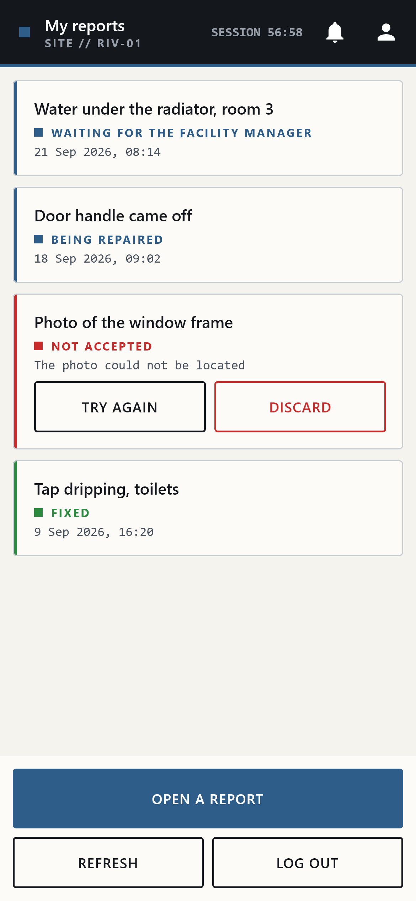
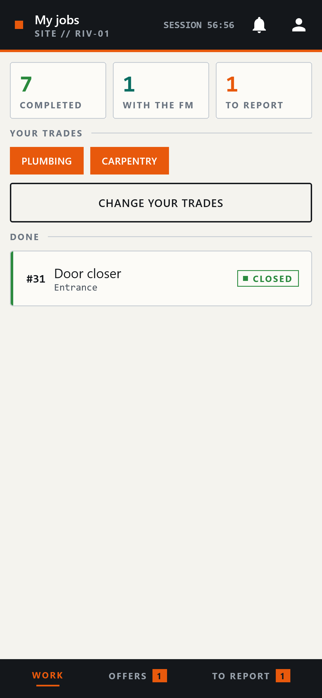
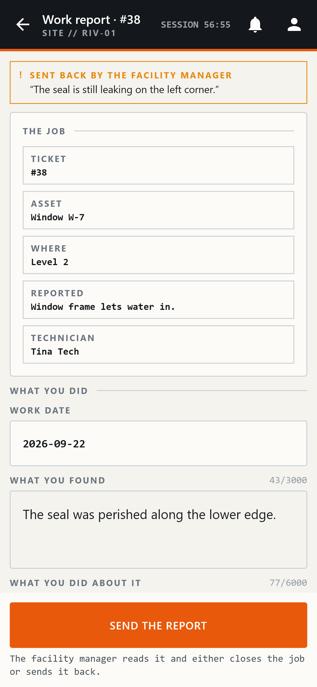
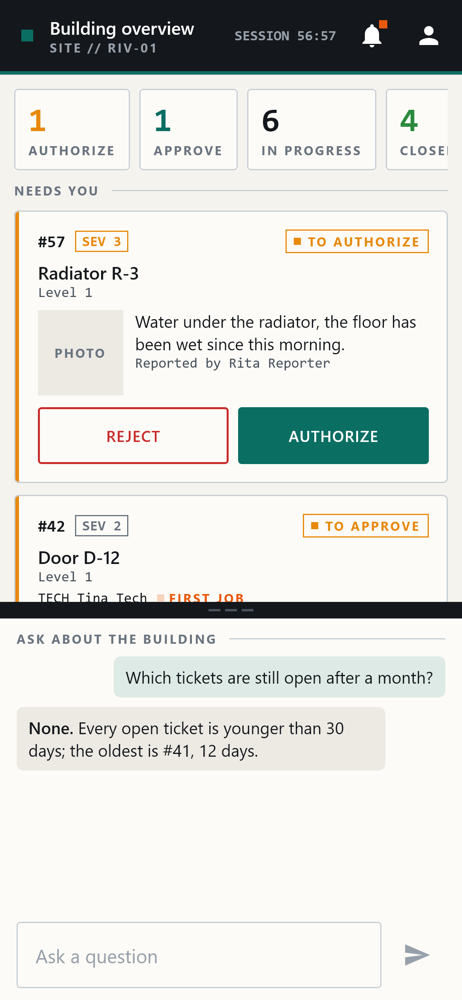

<div align="center">

# CBM Capture

**Android app for community-based building maintenance.**<br>
Occupants report defects with a photo, facility managers approve the work, technicians carry it out.

[](https://github.com/Coob-hash/cbm-capture/actions/workflows/ci.yml)
[](LICENSE)
[](https://developer.android.com/about/versions/oreo)
[](https://kotlinlang.org)

&nbsp;
&nbsp;
&nbsp;


</div>

## About

CBM Capture is the mobile client of a community-based maintenance (CBM) platform. Anyone in a
building can report a problem with one tap on a photo; the facility manager authorizes the
intervention; a technician accepts the job, fixes it and files a report; the facility manager
approves the result.

Every photo is sent together with the camera's own calibration (its intrinsic matrix), and the
image, the calibration and the tap are transformed as one. The server can therefore cast a ray from
the exact pixel the user pointed at and identify the element of the building model it hits,
instead of guessing from the image alone.

## Features

- **One app, three roles:** reporters, technicians and facility managers each get their own home
  screen after a single sign-in.
- **Tap to report:** one tap takes the photo and marks the defect.
- **Calibrated capture:** intrinsics from ARCore, the Camera2 factory calibration or EXIF, kept
  consistent with the image through every rotation and resize, and checked for plausibility.
- **Offline first:** captures are stored on the device and uploaded in the background.
- **Join by QR code:** scanning a site's poster signs you up for that site.
- **Technicians:** job offers matched to their trades, and a work report with an after photo.
- **Facility managers:** authorization and approval queues, notifications and a building
  assistant chat.

## Getting started

### Requirements

- Android Studio Ladybug (2024.2.1) or newer, JDK 17 and Android SDK 35
- A device running Android 8.0 (API 26) or later; AR capture needs an
  [ARCore-supported device](https://developers.google.com/ar/devices)
- A server implementing the API in [`contract/`](contract). The reference server is not part of
  this repository.

### Build and install

```bash
git clone https://github.com/Coob-hash/cbm-capture.git
cd cbm-capture
./gradlew :app:installDebug
```

### Configuration

The server's base URL is a build setting and is never committed. Add it to `local.properties` in
the project root:

```properties
cbm.apiBaseUrl=https://api.example.com/
```

or pass `-Pcbm.apiBaseUrl=https://api.example.com/` to Gradle. Without it, the app is built
against a placeholder address and cannot sign in.

## Testing

```bash
./gradlew testDebugUnitTest   # unit tests, no device needed
./gradlew :app:lintDebug      # Android lint
```

## Tech stack

| Area        | Libraries                                                  |
|-------------|------------------------------------------------------------|
| UI          | Jetpack Compose, Compose Multiplatform, Material 3         |
| Camera      | ARCore, CameraX, Camera2, ZXing                            |
| Persistence | Room, DataStore, EncryptedSharedPreferences                |
| Networking  | Retrofit, OkHttp, kotlinx.serialization                    |
| Platform    | Hilt, WorkManager, Navigation Compose                      |

## Project structure

```text
├── app/        Android application: camera, networking, storage, background upload
├── shared/     Kotlin Multiplatform module: domain model, capture geometry, UI
├── contract/   OpenAPI description and capture JSON Schema
└── docs/       Architecture, camera intrinsics specification, screenshots
```

## Documentation

- [Architecture](docs/architecture.md)
- [Camera intrinsics](docs/camera-intrinsics.md)
- [API contract](contract/README.md)
- [Changelog](CHANGELOG.md)

## Contributing

Contributions are welcome. Please read the [contributing guide](CONTRIBUTING.md) and the
[code of conduct](CODE_OF_CONDUCT.md) first. To report a security vulnerability, see
[SECURITY.md](SECURITY.md).

## License

Distributed under the Apache License 2.0. See [LICENSE](LICENSE).
