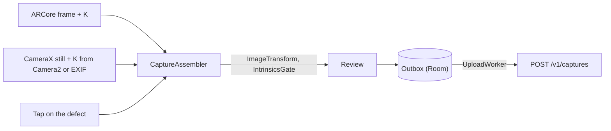

# Architecture

CBM Capture is a single Android app with a separate experience for each role. It talks to one HTTP
API, described in [`contract/openapi.json`](../contract/openapi.json); every decision is validated
and applied on the server, and the app only carries what the person on the screen decided.

## Modules

| Module    | Type                       | Contents                                                                 |
|-----------|----------------------------|--------------------------------------------------------------------------|
| `:shared` | Kotlin Multiplatform       | Domain model, capture geometry, design system and the role screens       |
| `:app`    | Android application        | Camera, networking, persistence, background work, view models, navigation |

`:shared` targets Android, plus a desktop JVM target used only to render screenshots. Its
`commonMain` source set must stay platform-independent: the `checkCommonMainIsPlatformFree` task
fails the build if it references `android.*` or `java.*`, so an iOS target can be added without
restructuring.

```text
shared/src/commonMain/kotlin/ai/cbm/capture/
├── domain/
│   ├── imaging/        ImageTransform, StillFraming: K, image and tap transformed together
│   ├── intrinsics/     IntrinsicsGate, Camera2Calibration
│   └── model/          API wire types (kotlinx.serialization)
└── ui/
    ├── design/         Component kit: buttons, inputs, cards, badges, top bar
    ├── theme/          Colours, typography, role accents
    ├── auth/           Join, sign-in, sign-up, role selection
    ├── reports/        Reporter home
    ├── technician/     Offers, jobs, trades, work report
    └── fm/             Facility manager queues, notifications, assistant

app/src/main/java/ai/cbm/capture/
├── app/                Application, MainActivity, navigation
├── di/                 Hilt module (OkHttp, Retrofit, Room, capture components)
├── data/
│   ├── capture/        ARCore and CameraX controllers, intrinsics readers, CaptureAssembler
│   ├── local/          Room outbox
│   ├── remote/         Retrofit API, upload and error classification
│   ├── session/        Encrypted session store
│   ├── settings/       DataStore preferences
│   └── work/           Facility manager and technician calls
├── domain/repository/  CaptureRepository: capture, outbox and upload
├── ui/                 View models and Android-only screens (camera, review, QR scanner, settings)
└── work/               UploadWorker
```

## Roles and sessions

A person signs up for a site by entering its code or scanning its QR poster
(`cbmapp://join?site=<code>`), and picks a role. The server returns their memberships, and
`MainActivity` routes each session to the home screen of its role:

| Role               | Home                                                                   |
|--------------------|------------------------------------------------------------------------|
| Reporter           | Their reports and their status, and the camera                         |
| Technician         | Job offers, jobs in progress, work to report, and their trades         |
| Facility manager   | Interventions to authorize, completed work to approve, the assistant   |

A session lasts one hour. Its token is kept in `EncryptedSharedPreferences` and removed on sign-out
or expiry. Several people can share one phone: photos waiting in the outbox stay with the account,
and the site, they were taken for.

## Capture pipeline



1. **Camera.** On devices that support ARCore, the frame, its intrinsics and its pose are read at
   the instant of the tap. Elsewhere, CameraX takes a still, and K comes from the Camera2 factory
   calibration or the photo's EXIF data. The tap is both the shutter and the position of the
   defect.
2. **Assembly.** `CaptureAssembler` rotates the image upright, downscales it, and applies the same
   transform to K and to the tap, then checks K with `IntrinsicsGate`. See
   [camera-intrinsics.md](camera-intrinsics.md).
3. **Review.** The user confirms the marker and adds a description.
4. **Outbox.** The JPEG and its metadata are stored in a Room table before anything is sent, so a
   capture survives restarts, a flat battery and a change of account.
5. **Upload.** `UploadWorker` (WorkManager) drains the outbox whenever a network is available, or
   only on Wi-Fi if mobile data is turned off in Settings. `CaptureUploader` classifies each answer:
   transient failures are retried with back-off, refusals are shown to the user, and a capture
   for another site waits until its own site's session.

The wire format of a capture is specified by
[`contract/capture-metadata.schema.json`](../contract/capture-metadata.schema.json).

## Build checks

Besides unit tests and Android lint, two Gradle tasks run before every build:

- `checkCommonMainIsPlatformFree` keeps `:shared/commonMain` free of platform APIs.
- `checkVisibleTextIsPlain` fails the build when on-screen text uses internal vocabulary, such as
  protocol names, status codes or camera terminology.

## Screenshots

`./gradlew :shared:screenshots` renders every screen with sample data to
[`docs/screenshots`](screenshots), at 390 x 844 dp, on the desktop target. No device or emulator is
needed.
